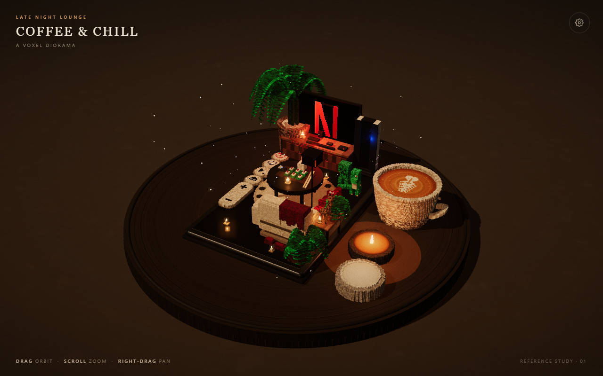

# Coffee & Chill — Voxel Diorama

A single-file, interactive 3D voxel diorama of a late-night coffee lounge: a maroon sofa, a poker table, a big-screen TV, palms, candles, a giant latte, and a couple of uninvited guests.

Built with [Three.js](https://threejs.org/) and rendered from ~120k instanced voxels — no build step, no assets, just `index.html`.

**Live demo:** https://dpsh613.github.io/coffee-chill/



## Features

- **Voxel scene** — everything is generated procedurally in code: ~120,000 instanced cubes split into six material batches (matte, fabric, wood, gloss, metal, glow).
- **Studio lighting** — HDR-ish studio environment, bloom pass, soft shadows, flickering practical lights (TV, candles, lamp).
- **Controls** — drag to orbit, scroll to zoom, right-drag to pan, double-click to recentre.
- **Settings panel** — exposure, key light, ambient, practical glow, bloom, turntable speed.
- **Toggles** — auto-spin, fireflies, shadows, and a "voxel view" wireframe mode.
- **Extras** — reset view, PNG snapshot, fullscreen, hide UI (`H`), reset camera (`R`).
- **Responsive** — layouts adapt down to phone widths.

## Run locally

ES modules are loaded from the CDN, so serve the file over HTTP (opening `file://` may be blocked by the browser):

```bash
python -m http.server 8080
# then open http://localhost:8080
```

Or with Node:

```bash
npx serve .
```

## Deployment

GitHub Pages serves this repository from `main` (root). Pushing to `main` rebuilds the site automatically — nothing to compile, the single `index.html` is the deployable artifact.

## Project layout

```
index.html    the entire diorama (markup, styles, scene, UI)
preview.png   screenshot used in this README
LICENSE       MIT
references/   mood-board references (local only, git-ignored)
```

## License

Code released under the [MIT License](LICENSE). Reference imagery in `references/` is not included in the repository.
